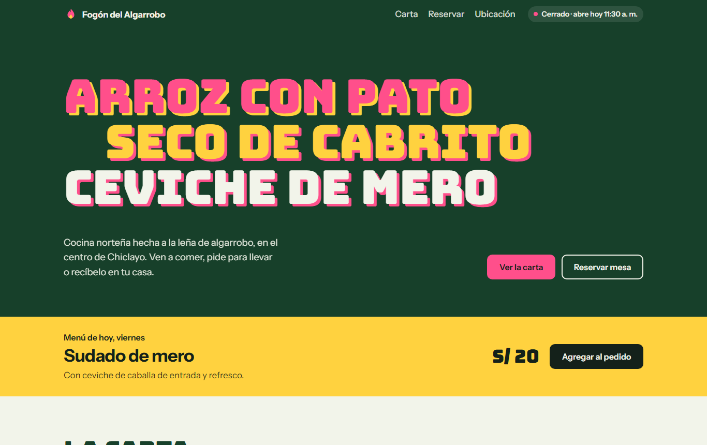

# Fogón del Algarrobo

Web para una picantería norteña de Chiclayo: carta digital, menú del día, pedidos y reservas que llegan directo al WhatsApp del negocio.

> **Fogón del Algarrobo es un restaurante ficticio.** Este proyecto es una demostración que puede adaptarse a cualquier restaurante en minutos.



## Qué hace

- **Carta digital** por categorías, con navegación fija que resalta la sección que estás viendo.
- **Pedidos por WhatsApp:** el cliente arma su pedido, elige recojo o delivery y la web genera el mensaje con el detalle y el total, listo para enviar.
- **Reservas por WhatsApp:** solo ofrece horas en las que el local está abierto, hasta una hora antes del cierre, y bloquea los días de descanso.
- **Menú del día** que cambia automáticamente según el día. Los lunes hay espesado, como manda la tradición chiclayana.
- **"Abierto ahora"**: indica si el local está abierto según la hora de Perú, sin importar desde dónde se visite la web.
- **Pedido guardado:** si el cliente cierra la página, su pedido sigue ahí al volver.
- Mapa, dirección y horario, con el día actual resaltado.

## Pensada para el celular

La mayoría de clientes llega desde Instagram o WhatsApp, así que el diseño parte del móvil: botones grandes, barra del pedido siempre a mano y formularios que validan en español y explican qué falta corregir.

También es accesible: se puede usar completa con teclado, tiene foco visible y respeta la opción de "reducir movimiento" del sistema.

## Diseño

La identidad combina dos referencias locales:

- **Verde culantro**, del arroz con pato, como color base.
- **Carteles chicha**, los afiches de letras gruesas y colores fosforescentes de las calles peruanas, para la portada.

Tipografías: [Bungee](https://fonts.google.com/specimen/Bungee) para los titulares e [Instrument Sans](https://fonts.google.com/specimen/Instrument+Sans) para el texto.

## Tecnología

HTML, CSS y JavaScript, sin frameworks ni dependencias. La web carga rápido incluso con datos móviles y se puede alojar gratis en GitHub Pages.

```
index.html        Estructura de la página
css/estilos.css   Estilos y diseño responsive
js/datos.js       Datos del negocio: nombre, WhatsApp, horario, carta y menú del día
js/app.js         Lógica: pedido, reservas, horario y mensajes de WhatsApp
```

## Adaptarla a otro restaurante

Todo el contenido está en [`js/datos.js`](js/datos.js). Para usarla en otro negocio:

1. Cambia el nombre, el número de WhatsApp, la dirección y el horario.
2. Reemplaza los platos de la carta y el menú de cada día.
3. Actualiza los colores en las variables al inicio de `css/estilos.css`.

## Ejecutarla en tu computadora

Basta con abrir `index.html` en el navegador, o levantar un servidor local:

```bash
python -m http.server 5173
```

## Autor

Hecho por [Rubén Rojas](https://github.com/JBen-Rjc).
